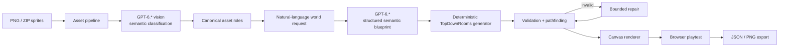
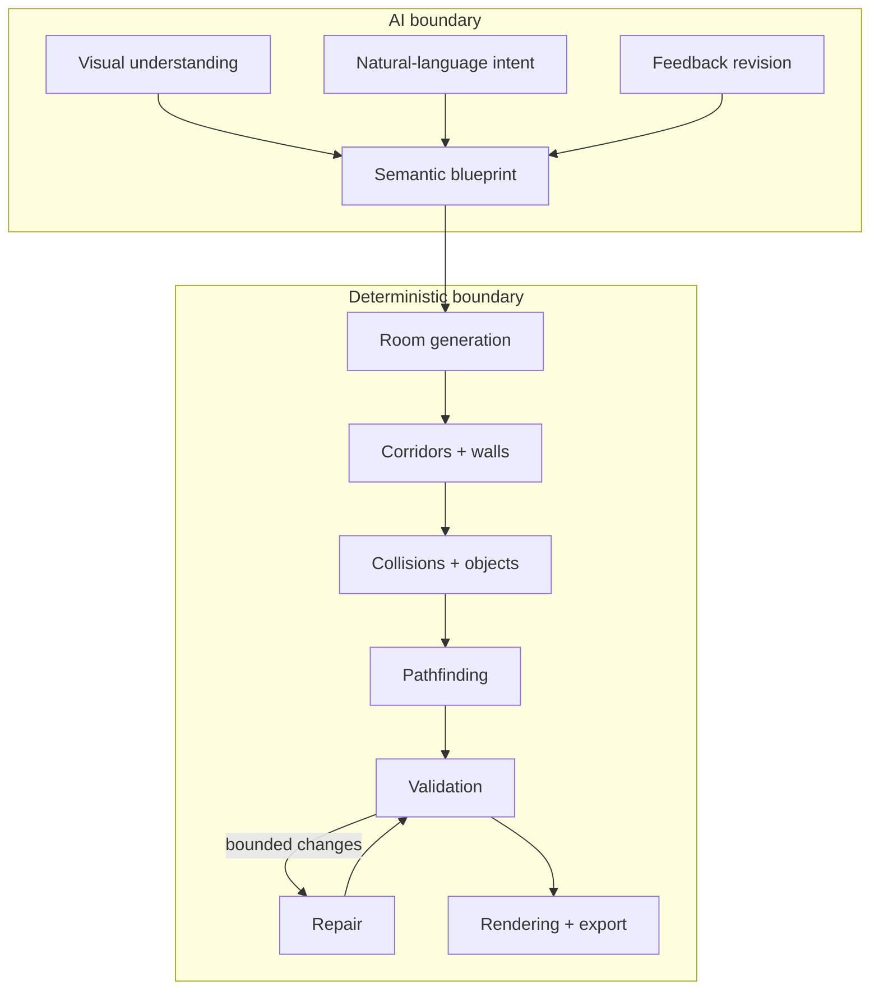

<div align="center">

# Ludic-Raster-Weave

### AI-assisted world generation for 2D games — with deterministic engineering underneath.

[](https://dotnet.microsoft.com/)
[](https://learn.microsoft.com/aspnet/core/blazor/)
[](https://www.docker.com/)
[](https://developers.openai.com/api/docs/models/gpt-6-astra)
[](LICENSE)

**Give it sprites. Give it intent. Get a playable world.**

</div>

---

## What this is

Ludic-Raster-Weave is a containerized AI-assisted level-design system for turning **pixel-art assets and natural-language world descriptions into structured, playable 2D worlds**.

The system does not ask a language model to invent a final tile map one coordinate at a time. Instead, the AI produces a **small semantic blueprint** and the application takes responsibility for everything that must be reproducible:

- geometry
- corridors
- walls
- collisions
- object placement
- start and exit conditions
- reachability
- validation
- bounded repair
- rendering
- export

That boundary is intentional.

> **GPT-6.* handles intent. Ludic-Raster-Weave handles reality.**

The result is an AI workflow that remains inspectable, deterministic where it matters, and testable without trusting the model to get every coordinate right.

---

## The system at a glance



The important part is the middle:

**AI produces intent; deterministic code produces state.**

---

## Why the architecture looks this way

A generated world is useful only when it is:

1. **Valid** — the map must obey the game's rules.
2. **Reachable** — a player must be able to get from start to exit.
3. **Reproducible** — the same seed and inputs should produce the same structure.
4. **Editable** — changing the semantic intent should not require hand-editing hundreds of coordinates.
5. **Inspectable** — the system should expose what the AI decided before the renderer turns it into pixels.

So the application keeps the model away from low-level layout mechanics.



This is the core engineering decision of the project.

---

## Powered by GPT-6.*

Ludic-Raster-Weave is built around the **OpenAI Responses API** and can use the GPT-6.* line as its AI layer. The current flagship integration target is **GPT-6 Astra**, OpenAI's model for demanding reasoning, coding, computer-use and professional workloads.

Inside the product, GPT-6.* is used where semantic interpretation is valuable:

- **Sprite understanding** — classify imported images into stable semantic roles.
- **World design** — translate natural-language intent into a strict, schema-constrained blueprint.
- **Feedback iteration** — revise the blueprint from contextual user feedback.

The model is **not** responsible for emitting a giant list of raw tile coordinates. The application owns generation, validation and playability.

That separation gives the system a useful property:

> **The model can be replaced or upgraded without rewriting the world generator.**

Model choice is configuration, not architecture.

[GPT-6 Astra model reference →](https://developers.openai.com/api/docs/models/gpt-6-astra)

---

## What it does

### Asset ingestion

- PNG, multi-PNG and ZIP import
- browser-supported folder import
- PNG signature and `IHDR` validation
- stable content IDs
- duplicate rejection
- normalized relative paths
- ZIP-slip / path-traversal protection
- manual role overrides
- searchable asset library

### AI layer

- image-assisted sprite classification
- semantic world design
- strict structured output
- contextual feedback revision
- model selection through configuration
- user-safe failure handling

### World generation

The first production grammar is deliberately narrow:

`TopDownRooms`

It supports:

- rooms
- orthogonal corridors
- loops
- walls
- collisions
- objects
- start and exit placement
- seeded generation
- independent pathfinding
- reachability validation
- bounded obstacle repair

### Editor and playtest

- desktop-first dark Blazor interface
- three-column editor
- canvas rendering
- pan / zoom / grid
- minimap
- keyboard playtest
- WASD / arrow-key movement
- version history
- contextual improvement loop
- JSON project export
- PNG preview export

### Persistence

Projects are persisted as JSON files in a named Docker volume.

There is no database dependency in the current design.

---

## The end-to-end loop

```text
IMPORT
  ↓
CLASSIFY
  ↓
DESCRIBE
  ↓
BLUEPRINT
  ↓
GENERATE
  ↓
VALIDATE
  ↓
REPAIR (only when needed)
  ↓
PLAYTEST
  ↓
FEEDBACK
  ↓
REVISE
  ↓
EXPORT
```

A user therefore works at the level of **intent**, while the engine works at the level of **constraints**.

---

## Quick start

The easiest path is Docker.

### Requirements

- Docker Desktop, or Docker Engine with Docker Compose
- a Git client

You do **not** need a local .NET SDK, Node.js installation or database just to run the containerized application.

### Run

```bash
git clone https://github.com/YOUR_USERNAME/Ludic-Raster-Weave.git
cd Ludic-Raster-Weave

docker compose up -d --build --wait
```

Open:

```text
http://localhost:3000
```

The application can start without an OpenAI key. AI features require a configured key.

> [!NOTE]
> The first container build may take several minutes while the .NET image and dependencies are restored. Subsequent builds reuse Docker's cache.

### Use another port

```powershell
$env:SPRITE2WORLD_PORT="3100"
docker compose up -d --build --wait
```

Then:

```text
http://localhost:3100
```

### Stop

```bash
docker compose down
```

### Stop and remove persisted project data

```bash
docker compose down -v
```

Use the second command only when you intentionally want to remove the named volume containing saved projects.

---

## OpenAI configuration

The application supports two configuration paths.

### 1. In-app key

During first-start onboarding, enter a personal OpenAI API key.

The application is designed so that the key is not committed to Git, persisted in project data, exported, or logged.

### 2. Server-side environment configuration

Create a local environment file:

```bash
cp .env.example .env.local
```

Then configure:

```env
OPENAI_API_KEY=your_key_here
OPENAI_DEFAULT_MODEL=gpt-6-astra
OPENAI_REASONING_EFFORT=high
```

Recommended GPT-6.* deployment:

```env
OPENAI_DEFAULT_MODEL=gpt-6-astra
```

The exact model available to you is controlled by your OpenAI account and API access. Keep model selection configurable rather than coupling application logic to one model identifier.

When an AI request fails, the application presents a user-safe error and can fall back to an explicit deterministic demo blueprint so the core workflow remains testable.

---

## AI contract

The AI side is intentionally compact.

| Stage | Model responsibility | Application responsibility |
|---|---|---|
| Sprite classification | Interpret image semantics | IDs, overrides, validation, persistence |
| World design | Produce a structured semantic blueprint | Coordinates, rooms, corridors, collisions, generation |
| Feedback | Revise semantic intent | Versioning, regeneration, validation, repair |
| Playability | None | Pathfinding, constraints and final state |

The system therefore treats the model as a **planner**, not as the game engine.

---

## Determinism

The generator is seeded.

That matters because procedural generation without repeatability is difficult to test and nearly impossible to debug cleanly.

The intended relationship is:

```text
same seed
+ same normalized assets
+ same semantic blueprint
+ same generator version
= same generated world
```

The model may change the blueprint.

The deterministic layer turns that blueprint into a reproducible world.

---

## Security model

This is a local developer tool, not an internet-facing multi-tenant service.

Current import defenses include:

- PNG-only image validation
- PNG signature / `IHDR` checks
- ZIP traversal protection
- normalized relative paths
- duplicate rejection
- bounded upload and extraction sizes
- uploads are never executed

Default limits:

| Constraint | Default |
|---|---:|
| Imported assets | 250 |
| Per-file size | 10 MB |
| Total extracted/upload size | 100 MB |

Do not expose the application directly to the public internet without adding authentication, HTTPS, request throttling and a deployment-specific security review.

---

## Testing

With a local .NET 10 SDK:

```bash
dotnet test Sprite2World.sln
```

Or with Docker only:

```bash
docker run --rm \
  -v "$PWD:/src" \
  -w /src \
  mcr.microsoft.com/dotnet/sdk:10.0 \
  dotnet test Sprite2World.sln
```

The test suite covers the parts of the system that are most likely to regress:

- blueprint serialization
- seeded determinism
- non-overlap
- connectivity and reachability
- start / exit rules
- collision behavior
- missing-role validation
- validator behavior
- repair logic
- ZIP traversal
- PNG encoding
- export completeness

---

## Repository structure

```text
.
├── src/
│   ├── Sprite2World.Domain/
│   ├── Sprite2World.Application/
│   ├── Sprite2World.Infrastructure/
│   ├── Sprite2World.Worker/
│   └── Sprite2World.Web/
├── tests/
├── docs/
├── compose.yaml
├── Dockerfile
├── Sprite2World.sln
├── ARCHITECTURE.md
├── LICENSE
├── THIRD_PARTY_NOTICES.md
└── README.md
```

The exact layout may evolve, but the architectural split is the important part:

```text
Domain
  ↓
Application
  ↓
Infrastructure / Worker
  ↓
Web
```

AI integration sits at the boundary where semantic work is needed; deterministic generation remains isolated from model-specific behavior.

---

## Design constraints

Ludic-Raster-Weave intentionally does **not** claim to be a general-purpose game engine.

The first reliable grammar is `TopDownRooms`.

The following are extension points rather than current promises:

- overworld generation
- city generation
- platformer layouts
- auto-tiling
- animation pipelines
- engine-specific exports

This keeps the current system small enough to reason about.

A smaller deterministic core is more valuable than a giant feature list that cannot be tested.

---

## Typical workflow

1. Start the application.
2. Import a PNG or ZIP sprite pack.
3. Review or classify the assets.
4. Describe the world in natural language.
5. Generate a semantic blueprint.
6. Inspect the generated structure.
7. Run validation.
8. Playtest in the browser.
9. Give contextual feedback.
10. Regenerate or restore a previous version.
11. Export JSON / PNG.

The interesting part is that the user never has to manually author hundreds of tile coordinates.

---

## Failure philosophy

AI failure should not become system failure.

The application therefore follows a simple rule:

```text
AI can be uncertain.
The generated world cannot be silently invalid.
```

When the model produces something unusable, the deterministic layers are responsible for detecting it, rejecting it or repairing it within bounded rules.

That is why validation is not an afterthought. It is part of the generation pipeline.

---

## Status

This repository represents an MVP-quality engineering baseline for AI-assisted deterministic 2D world construction.

The system is intentionally opinionated:

- one focused world grammar
- explicit AI / engine boundaries
- deterministic generation
- validation before playtesting
- containerized execution
- configuration-driven model selection

That makes the project easier to extend without making correctness someone else's problem.

---

## Documentation

- [Architecture](ARCHITECTURE.md)
- [Third-party notices](THIRD_PARTY_NOTICES.md)
- [License](LICENSE)

---

<div align="center">

**Ludic-Raster-Weave**

*Natural language in. Deterministic worlds out.*

**Powered by GPT-6.* · Engineered for reproducibility.**

</div>
